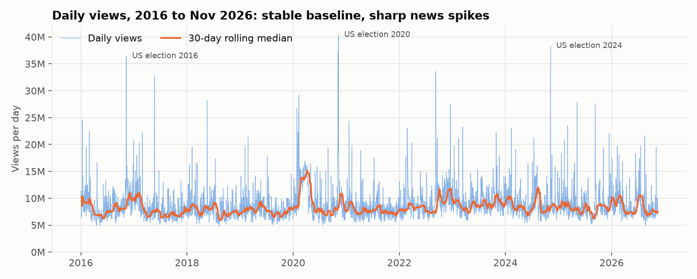
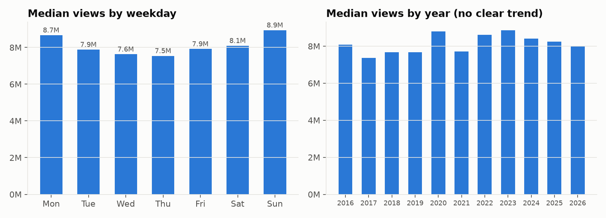
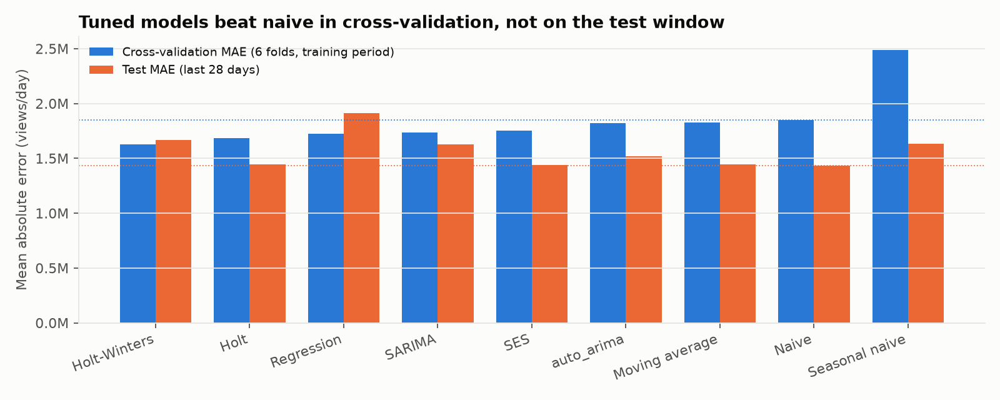
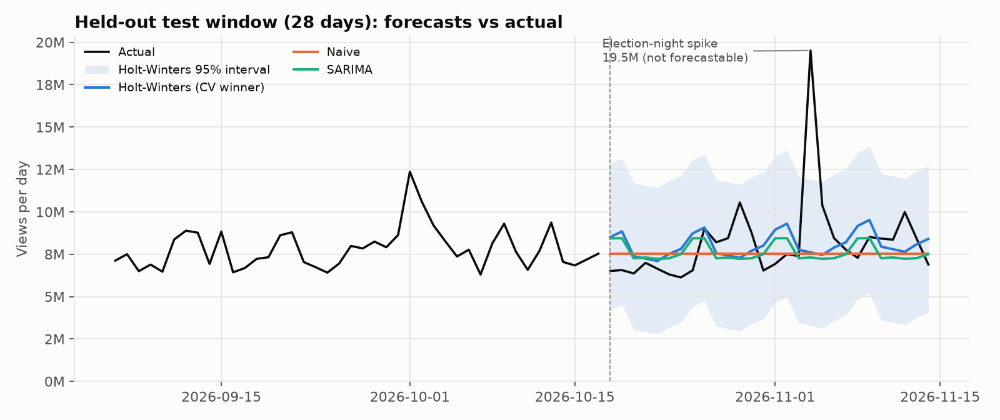
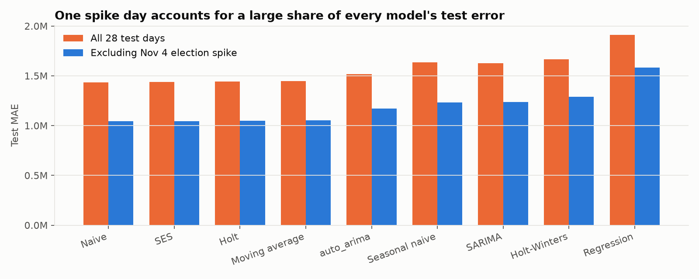
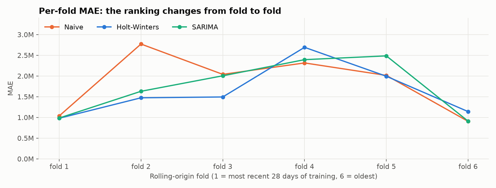
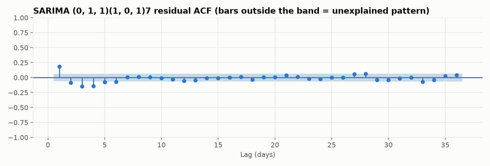
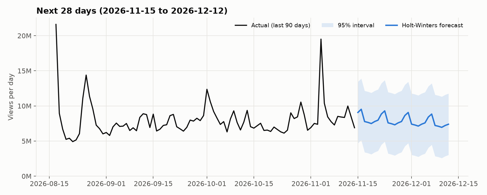

# Forecasting daily Wikipedia page views: final report

**Question.** How well can the course techniques (regression, moving average, simple/double/triple exponential smoothing, ARIMA) forecast the next 28 days of total daily views, and which should we trust?

**Short answer.** On a held-out 28-day window, no tuned model beat the naive "tomorrow equals today" forecast. In cross-validation on the training period, Holt-Winters (multiplicative) was about 12% better than naive, but that edge did not hold on the test window, and it won only 4 of 6 folds. The series is a stable baseline of roughly 7 to 9 million views a day plus unpredictable news spikes, and the spikes dominate the error. Use the forecast as a central estimate with wide bands, not as a precise number.

All numbers come from `results/` and `report/numbers.json`. Reproduce with the commands in the README.

---

## 1. Data and quality checks

**Source.** `data/pageviews.csv`: 396,000 rows, one per (day, article), the top 100 articles each day from 2016-01-01 to 2026-11-14. I summed `views` per day to get one number per day (`data/daily_views.csv`).

**Important scope note.** Each daily total is the sum of the *top 100 articles only*, not all Wikipedia traffic. When a viral article enters or leaves the top 100, the total moves for reasons unrelated to demand.

| Check | Result | Handling |
|---|---|---|
| Rows per day | Exactly 100 on all 3,960 days | none needed |
| Duplicate (day, article) rows | 0 | none needed |
| Missing days | 11 of 3,971 (0.28%): 2025-06-28, 2025-07-18, 2025-07-20, 2026-03-01, 2026-04-17, 2026-04-18, 2026-05-22, 2026-05-23, 2026-08-01, 2026-08-14, 2026-10-16 | linear interpolation, the course default. Too few to matter, all after mid-2025, and 2026-10-16 sits inside training. |
| Null cells | 7, all in the `article` name column (rows still have valid `views`) | kept. Totals sum `views`, so these rows are counted. |
| Non-positive totals | 0 | none needed |
| Outliers | 103 days (2.6%) sit more than 80% above their 29-day rolling median; the largest is 40.4M on 2020-11-08 | **kept, not removed.** They are real events and the thing a forecaster has to live with. Section 4 reports results with and without the test-window spike. |

Sample size is 3,960 days, enough for weekly seasonality. It is a single series, so any conclusion about "which model is best" rests on a small number of test windows (see limits).

## 2. What the data looks like



The 30-day median stays between about 6M and 11M for ten years, with one long excursion in early 2020 (to about 15M). Everything above the median line is a news spike: US election days in 2016, 2020 and 2024, plus unscheduled events. Mean daily views are 8.78M, median 8.09M, and the coefficient of variation is 0.33, mostly from the spikes.



- **Weekly pattern is real but small.** Sunday has the highest median (8.94M) and Thursday the lowest (7.54M), a gap of 19%. Spikes are several times larger than this weekly swing.
- **No trend.** Yearly medians range from 7.4M (2017) to 8.9M (2023) with no direction. That is why trend-based models gain little.

## 3. Method

- **Split.** Test = the last 28 days (2026-10-18 to 2026-11-14), four full weekly cycles, never used for tuning. Train = everything before.
- **Tuning.** Six rolling-origin folds inside the training period, each forecasting 28 days ahead. A config's score is its mean MAE over the six folds. I chose MAE because RMSE is dominated by a handful of spike days; all four course metrics (ME, MAE, RMSE, MAPE) are saved in `results/`.
- **Two rounds.** Round 1: 323 configs on a broad grid. Round 2: 507 configs in the neighborhood of each family's top three. Everything ran in parallel on 8 worker processes (150 s and 279 s).
- **Models.** Naive, seasonal naive (m=7), moving average, simple (SES), double (Holt), and triple (Holt-Winters) exponential smoothing, OLS regression (trend or cubic spline, day-of-week dummies, annual Fourier terms), SARIMA with explicit orders, and `pmdarima.auto_arima`. Tuned: training window (1 to 5 years), smoothing parameters, additive vs multiplicative seasonality, log transform, ARIMA orders.
- **Intervals.** Native 95% intervals for regression and ARIMA. For the smoothing models and baselines I used the in-sample residual standard deviation (an approximation).

## 4. Results



| Model | Configs tried | CV MAE | Test MAE | Test RMSE | Test MAPE |
|---|---|---|---|---|---|
| Holt-Winters (triple), multiplicative, 365-day window | 240 | **1.63M** | 1.67M | 2.71M | 18.4% |
| Holt (double), 730-day window | 48 | 1.69M | 1.44M | 2.61M | 14.7% |
| Regression, annual Fourier K=6, log, 730-day window | 133 | 1.73M | 1.91M | 2.74M | 23.3% |
| SARIMA (0,1,1)(1,0,1)₇ | 372 | 1.73M | 1.63M | 2.73M | 17.4% |
| SES | 23 | 1.75M | 1.44M | 2.61M | 14.7% |
| auto_arima, picked (1,0,0)(0,0,2)₇ on log scale | 2 | 1.82M | 1.52M | 2.46M | 17.6% |
| Moving average (N=7) | 10 | 1.83M | 1.45M | 2.61M | 14.8% |
| Naive | 1 | 1.85M | **1.43M** | 2.58M | 14.8% |
| Seasonal naive | 1 | 2.49M | 1.63M | 2.83M | 16.9% |

**Reading the table.**

1. **Cross-validation and the test window disagree.** Holt-Winters beats naive by 11.8% in CV (1.63M vs 1.85M) and loses by 16% on the test window (1.67M vs 1.43M). Holt, SES and the moving average sit within 1% of naive on test.
2. **The test window is hard.** It contains 2026-11-04, election-night, at 19.5M views (about 2.5x a normal day). Only the first figure below shows the damage; the second quantifies it.



Every model forecast about 8M for that day against 19.5M actual, a miss of 11M or more. Without that one day, test MAE falls by about 27% for naive (1.43M to 1.04M). That single day (1 of 28) accounts for about 30% of naive's total absolute test error.



The ranking on the other 27 days is nearly the same as on all 28 (two adjacent pairs swap places): naive, SES, Holt and the moving average first (about 1.05M), then auto_arima (1.17M), then seasonal naive, SARIMA and Holt-Winters (1.23M to 1.29M), with regression last (1.58M). So the spike did not flip the result; the naive-family models were simply hard to beat.

3. **No model wins consistently across folds.**



Against naive, Holt-Winters won 4 of 6 folds, regression 4 of 6, Holt and SARIMA 3 of 6, and SES, auto_arima, moving average and seasonal naive 2 of 6 each. Holt-Winters' worst fold (fold 4, 2.69M) was worse than naive's 2.31M on the same fold. With six folds of 28 days each, the 12% CV edge for Holt-Winters is not strong evidence of a real advantage.

4. **Round 2 helped a little, only for some families.** Best CV MAE went from 1.69M to 1.63M for Holt-Winters (-3.7%), 1.76M to 1.73M for SARIMA (-1.4%) and 1.74M to 1.73M for regression (-0.9%). Holt, SES and the moving average did not improve, so their round 1 winners stand.

## 5. Model diagnostics



Following the course notebook, I checked the residuals of the best SARIMA, (0,1,1)(1,0,1)₇. They are **not** white noise: lag 1 is +0.18 and lags 2 to 4 are about -0.09 to -0.15, all outside the band. Ljung-Box rejects "no autocorrelation" at lag 7 (Q=101.8, p=5e-19), lag 14 (Q=108.6, p=1e-16) and lag 28 (Q=121.1, p=1e-13). The model leaves short-memory structure unexplained, plausibly the multi-day decay after each spike (visible in the last 90 days in section 6), though I did not test that. The grid covered p and q up to 2 in round 1 and up to 4 around the top candidates in round 2, and the best model still fails the test. None of the ARIMA variants beat naive on test.

**Bias.** Test ME is positive for most models (naive +0.66M, SES +0.75M), meaning actuals ran above forecasts, driven by the spike. Regression is the exception (ME -0.75M): it over-forecast on average.

**Interval coverage.** The 95% intervals covered 27 of 28 test days (96.4%) for every model. The one miss is the election spike. The intervals are wide: the Holt-Winters band averages about 8.7M across (roughly 3.5M to 12.3M around a 7.9M forecast).

## 6. Forecast for 2026-11-15 to 2026-12-12



Refit on all data through 2026-11-14, the CV-best model (Holt-Winters, multiplicative) forecasts a mean of **7.9M views/day**, starting at 9.1M on Sunday 11-15 (95% interval 4.7M to 13.4M) and following a weekly cycle of about 7M to 9.5M. Daily values are in `results/holt_winters/future_forecast.csv`.

Because naive, SES and Holt scored as well or better on the test window, treat 7.9M as one reasonable central estimate, not a clear winner. The two simplest models would put the level near the most recent values (7M to 8M).

## 7. Findings and recommendations

1. **Plan with the level and the band, not the point.** A typical day is 7M to 9M; the 95% band is about ±4.4M. Any decision that breaks at 13M views or 4M views needs its own buffer.
2. **Spikes are the main source of error and are not forecastable from history.** About 30% of the naive model's test error came from one day. A realistic improvement is an **event indicator** (scheduled elections, major releases) rather than a better ARIMA order.
3. **Do not claim a winner on this evidence.** Holt-Winters has the best CV score; naive-family models have the best test score; fold-level wins are close to a coin flip. If you must pick one: Holt-Winters for its weekly shape and its better cross-validation score, SES or naive for simplicity. The difference between them is smaller than the noise.
4. **Weekly seasonality exists (Sunday +19% over Thursday) but contributes little accuracy** next to the spike noise. The best SARIMA had only a weak seasonal term.
5. **Retraining and monitoring.** Re-run `run.py` and `final.py` monthly. Revisit the models if the rolling 28-day MAE stays above about 2.7M (the worst fold seen in cross-validation) or if the level shifts, as it did in early 2020.

## 8. Limits

- **One test window.** 28 days is one draw, and it contains an election. A different window could reorder the models. The six CV folds help, but they cover only the most recent seven months of training data.
- **Top-100 totals, not total traffic.** Churn in the top 100 shifts the sum.
- **Heavy tails.** Daily totals have a long right tail. Gaussian-style intervals (regression, ARIMA, residual-sd bands) understate the upside risk.
- **Not tried:** exogenous event regressors, quantile or median forecasts, models for the log series beyond a few configurations, hierarchical forecasts by article, multi-seasonal (weekly + annual) state-space models. Annual seasonality is only covered by the regression's Fourier terms.
- **Missing days.** 11 interpolated days, none inside the test window.
- **Approximate intervals** for the smoothing models and baselines.

## 9. Reproducibility and LLM use

```
uv sync
uv run python forecasting/run.py 1        # round 1 grid (about 150 s on 8 cores)
uv run python forecasting/run.py 2        # round 2 refinement (about 280 s)
uv run python forecasting/final.py        # winners by CV, test scoring, per-model results
uv run python forecasting/report_figures.py
```

Code is split per model in `forecasting/models/`. Winners are chosen on CV only. This analysis was produced with Claude Code; if you submit it, verify the numbers against `results/` yourself and disclose the assistance.

---

**Status: DONE_WITH_CONCERNS.** Every model ran, results are saved per model, and figures and numbers regenerate from the scripts. Concerns: (1) the SARIMA residuals fail the Ljung-Box test, so the ARIMA family is not fully capturing the structure; (2) the model ranking is not stable between CV and the single test window; (3) I corrected one earlier claim: interval coverage is 96.4%, not 100%.
